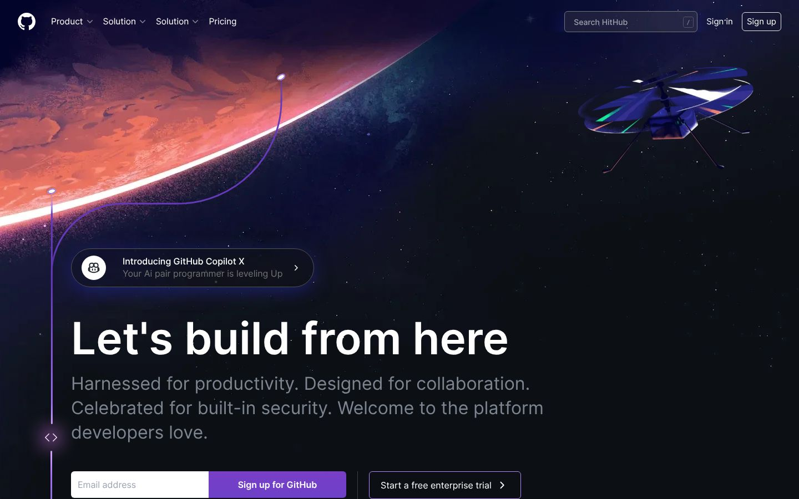
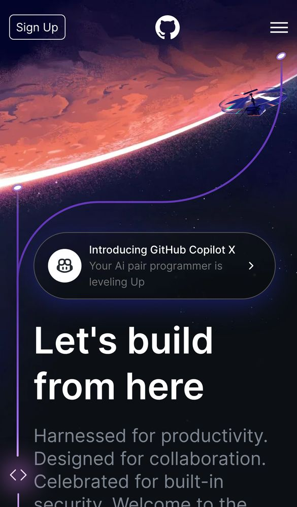
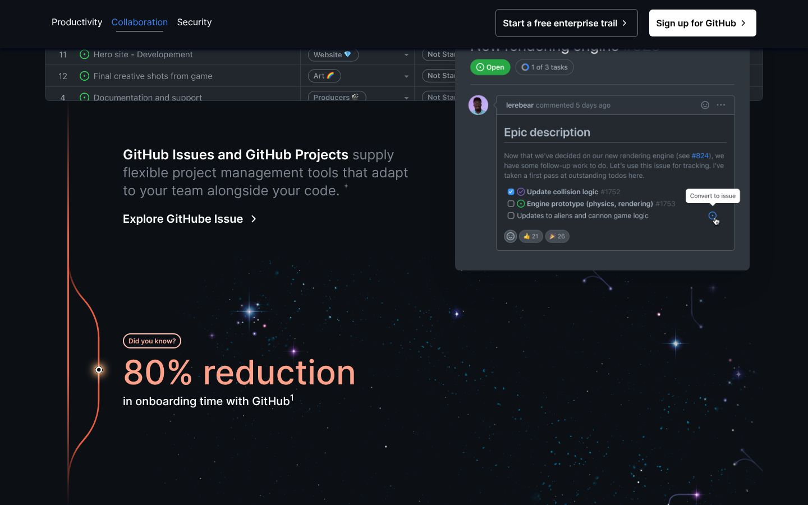

<div align="center">

# GitHub Homepage Clone

### A recreation of GitHub's 2023 marketing homepage, with a WebGL globe

A UI clone of the GitHub homepage built with Next.js, Tailwind CSS and Framer Motion. It includes the mega-menu navbar, a sticky section nav, scroll-triggered animations and an interactive 3D globe rendered with Cobe.

> **Practice project.** This is a UI clone I built to practise front-end skills. It is **not affiliated with, endorsed by or connected to GitHub, Inc.** The GitHub name, logo, artwork and copy belong to their owners.

[](https://nextjs.org)
[](https://react.dev)
[](https://www.typescriptlang.org)
[](https://tailwindcss.com)
[](https://motion.dev)
[-1F2937)](https://github.com/shuding/cobe)
<br>
[](https://eslamraafat1.github.io/GitHub-Clone/)

**[Live demo](https://eslamraafat1.github.io/GitHub-Clone/)** ·
**[Portfolio](https://new-portfolio-ashy-xi.vercel.app/)** ·
**[LinkedIn](https://www.linkedin.com/in/eslamraafat-dev/)** ·
**[Email](mailto:eslamraafat736@gmail.com)**

<br>



</div>

<table>
  <tr>
    <td width="33%"></td>
    <td width="67%"></td>
  </tr>
  <tr>
    <td align="center"><sub>Mobile (iPhone 13)</sub></td>
    <td align="center"><sub>Collaboration section with the sticky section nav</sub></td>
  </tr>
</table>

---

## Overview

GitHub's homepage is long and heavily animated, which makes it good practice for layout and motion. I rebuilt it section by section to practise:

- turning a complex, real-world page into **reusable React components**,
- responsive layouts with **Tailwind CSS** utility classes,
- scroll-triggered animation with **Framer Motion** (`whileInView`, variants),
- rendering a **WebGL** globe in a `<canvas>` with Cobe,
- exporting a **Next.js** app as a static site and deploying it to **GitHub Pages** with GitHub Actions.

## Features

- **Navbar** with Product, Solutions and Open Source mega-menus, a search field, sign-in and sign-up buttons, and a separate mobile menu.
- **Hero** with the layered space artwork, the Copilot announcement pill, an email sign-up form and an enterprise-trial button.
- **Sticky section nav** (Productivity · Collaboration · Security). It becomes fixed once you scroll past it and highlights the section in view, using `getBoundingClientRect` on scroll.
- **Productivity**: the Copilot feature, a code editor mock-up, a Codespaces block and hover cards.
- **Collaboration**: the Issues and Projects mock-ups, a discount card and animated statistic callouts.
- **Security**: the timeline-style section with animated progress lines and project cards.
- **3D globe** in the closing call-to-action, built with Cobe and rendered at a different size for small screens.
- **Footer** with link columns and footnotes.
- Hover micro-interactions on buttons, such as the sliding arrow icons.

## Tech stack

| Layer | Tools |
| --- | --- |
| Framework | Next.js 13.5 (App Router, `output: 'export'`) |
| UI library | React 18.2 |
| Language | TypeScript 5 |
| Styling | Tailwind CSS 3.3, PostCSS, Autoprefixer |
| Animation | Framer Motion 10.16 |
| 3D | Cobe 0.6 (WebGL globe) |
| Font | Inter via `next/font/google` |
| CI/CD | GitHub Actions → GitHub Pages |

## Project structure

```text
.
├── .github/workflows/nextjs.yml   # build + static export + deploy to GitHub Pages
├── next.config.js                 # output: 'export'
├── public/                        # hero artwork, globe texture, images
└── app/
    ├── layout.tsx                 # Inter font, metadata
    ├── page.tsx                   # page composition
    ├── globals.css
    └── components/
        ├── Navbar/                # Navbar, mega-menus, StickyNav
        ├── Hero Section/          # Hero
        ├── Productivity/          # Copilot, code editor, Codespaces, hover cards
        ├── Collaboration/         # Collaboration, Discount
        ├── Security/              # Security, Projects
        └── Footer/                # Globe section (Earth1 / Earth2 with Cobe), Footer
```

## Getting started

**Requirements:** Node.js 18 or newer and npm.

```bash
git clone https://github.com/Eslamraafat1/GitHub-Clone.git
cd GitHub-Clone
npm install
npm run dev        # http://localhost:3000
```

| Command | What it does |
| --- | --- |
| `npm run dev` | Start the Next.js dev server |
| `npm run build` | Build and export the static site to `out/` |
| `npm run lint` | Run ESLint (`eslint-config-next`) |

## Deployment

The site is deployed to **GitHub Pages** by [`.github/workflows/nextjs.yml`](.github/workflows/nextjs.yml) on every push to `master`. The workflow builds the app, exports static HTML to `out/` and publishes it: [live demo](https://eslamraafat1.github.io/GitHub-Clone/).

## Author

**Eslam Raafat** — Front-End Developer (React · Next.js · TypeScript)

- **Portfolio:** [new-portfolio-ashy-xi.vercel.app](https://new-portfolio-ashy-xi.vercel.app/)
- **LinkedIn:** [linkedin.com/in/eslamraafat-dev](https://www.linkedin.com/in/eslamraafat-dev/)
- **GitHub:** [@Eslamraafat1](https://github.com/Eslamraafat1)
- **Email:** [eslamraafat736@gmail.com](mailto:eslamraafat736@gmail.com)
